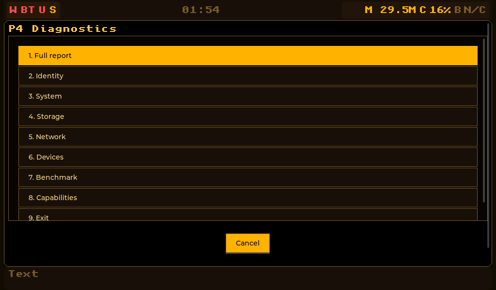
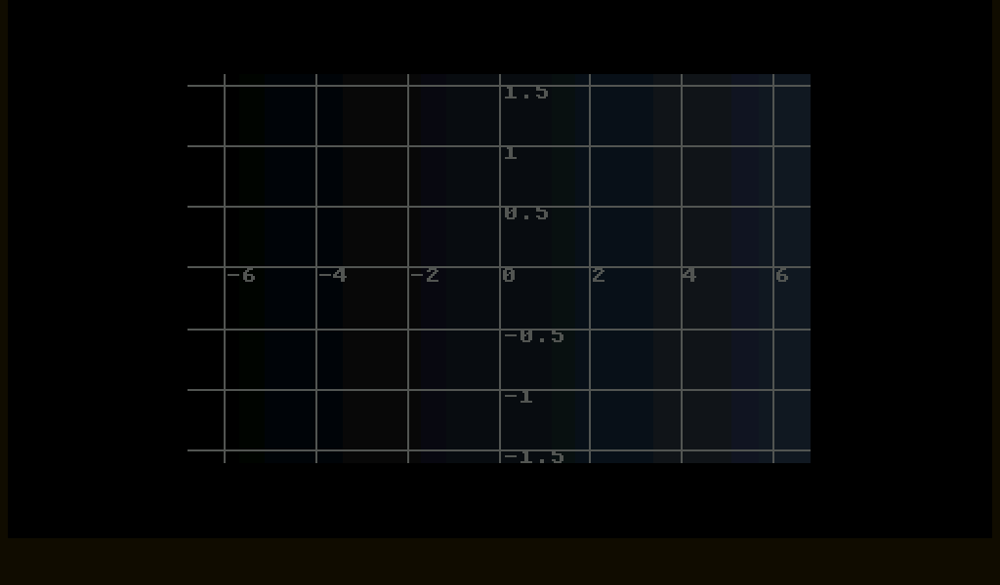
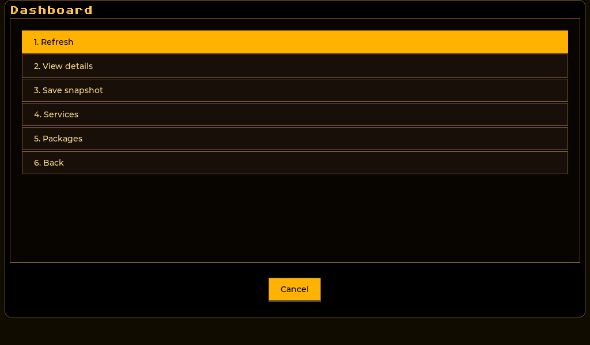
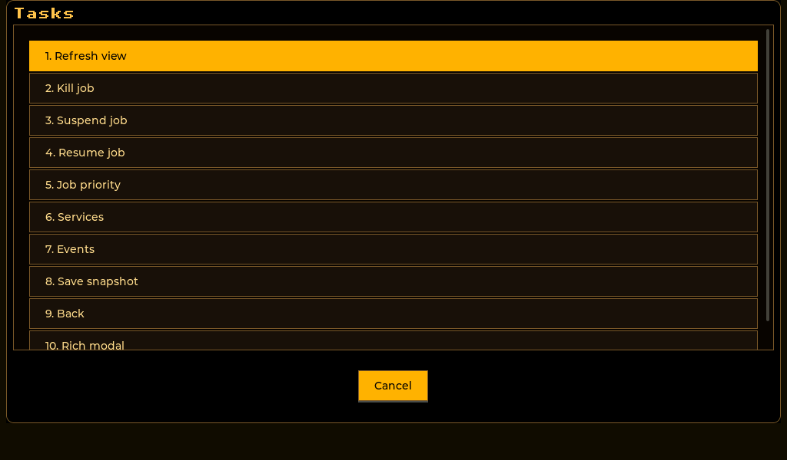
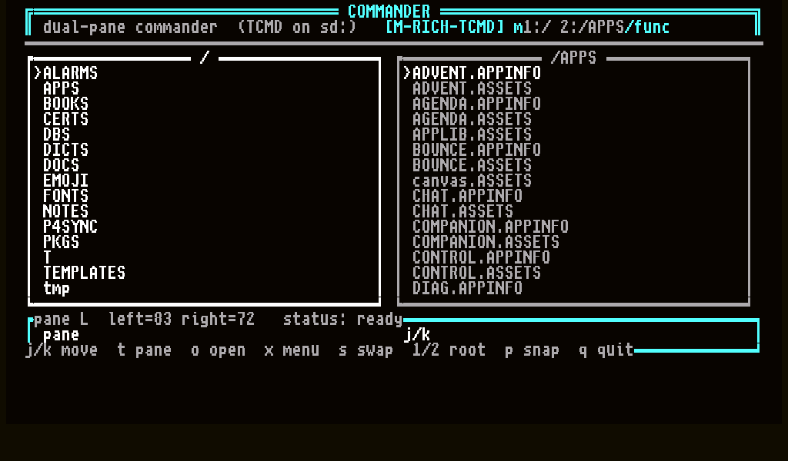
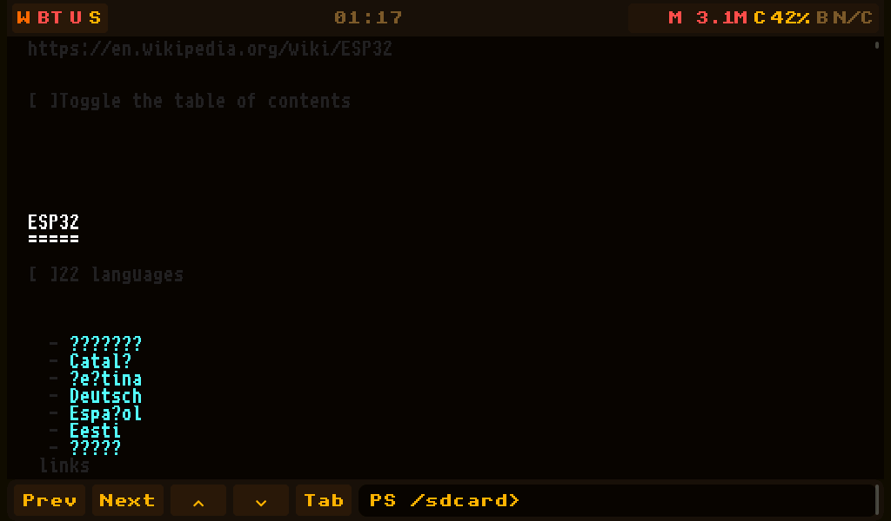
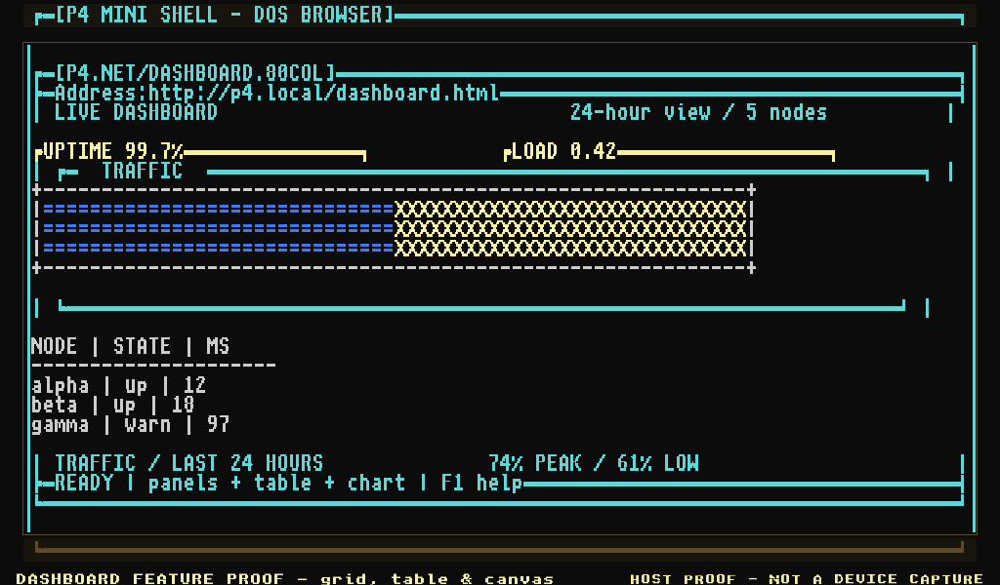

# Reference app gallery

Screenshots are normally captured live from the device by
[`tools/suites/s25_apps_gallery.py`](../tools/suites/s25_apps_gallery.py)
(JC1060P470C, 1024x600). Any image explicitly labelled a **host-generated
proof** is not a device capture; its caption says so and hardware recapture is
pending. The apps are batch-first and run from SD or USB; metadata comes from
each app's `APPINFO`.

The visual direction is a modern take on retro MS-DOS: an 80x25 CP437 cell grid,
box-drawn panels, the DOS/CGA palette, a chunky bitmap cell font, status bars
and keyboard menus — dense information and smooth interaction, not web cards or
gradients. Each app is being given a **distinct DOS screen** (its own panel
layout, status line and ASCII/CP437 chart or palette accent), with one flagship
showcase app. The captions below describe that screen identity; until a board
recapture lands, the images are older device captures or labelled host proofs.

The feature matrix in [`readme.md`](../readme.md) lists which surfaces each app
exercises. Every v1.6.0 app is richer: all **33 updated `.bat` apps** (plus the
new flagship `SHOWCASE.BAT`) emit an additive `[M-RICH-*]` marker block that
exercises the new batch/GFX/TUI/modal/webapp surfaces, and all pre-existing
`[M-*]` markers are preserved. The host
proof is `python tools/host_apps_gate.py --check` (34 apps including the
flagship, 679 host assertions PASS, 45 hardware surfaces honestly SKIP, 7 red
canaries); the
markers are not necessarily visible in the older gallery PNGs below, whose
**hardware recapture is pending**. The new transcript lines mean
`tools/appdiff/baseline/*.transcript.txt` goldens must be regenerated on a
board before hardware transcript parity can be green.

## Proof origin at a glance

| Capture | Origin |
|---------|--------|
| `apps/gfxtool.png` | **Host-generated proof** from the real gfx core (`tools/make_gfx_proof.py`); not a device capture |
| `web/portal.png`, `web/dashboard.png`, `web/article.png`, `web/form.png` | **Host-generated DOS-presentation proofs** from functional HTML/CSS/JS pages rendered through the real engine (`tools/make_web_screenshots.py`); committed under `screenshots/web/` with byte-identical copies in `docs/assets/web/`, not device captures |
| `web-features.png`, `webapp-forms.png` | **Host-generated DOS-presentation proofs** from the real DOM/CSS/canvas render (`tools/make_webapp_proof.py`); not device captures |
| `web/wiki_esp32.png` | **Host-generated first-screen proof** of the saved ESP32 Wikipedia fixture through the real DOM/CSS/sampler (`tools/host_browser_gate.py`): first 25 rows, not live HTTPS and not the full device page |
| Every other `apps/*.png` | Existing device capture from an earlier campaign; hardware recapture for the v1.6 markers and the DOS redesign is pending |
| `proof/web.png`, `proof/wikipedia_live.png` | Live device captures staged by `s21_wikipedia` (see `docs/assets/README.md`) |

The checked, labelled proof set is [`proof-index.html`](assets/proof-index.html).
All proof PNGs carry a `HOST PROOF - NOT A DEVICE CAPTURE` footer. The six DOS
page/form proofs are checked by `python tools/visual_proof_gate.py --check`
(red canaries via `--self-test`) for a real DOS-palette pixel share, CP437
box-border continuity, ink in the header/body/footer bands, no default-theme
blue or empty-box glyph runs, and a distinct signature per screen. The wiki
first-screen proof is checked by `python tools/host_browser_gate.py --check`
against the real renderer's emission. Both are board-free pre-gates, never
hardware sign-off (`harness.md` §2.1/§2.2).

## Flagship showcase (`SHOWCASE-MASTER`)

The flagship app lands with this redesign as `apps/showcase/SHOWCASE.BAT`
(identity `[M-DOS-SHOWCASE]`): `screen=SHOWCASE-MASTER`, `panels=6`,
`head="DOS SHOWCASE"`, `theme=ice`, three bars, a table, two sparklines and a
status line — one 80x25 DOS screen tiling proof panels for batch, TUI, modal,
webapp and gfx on a single ice-blue dashboard. It is the 34th app, additional to
the 33 `[M-RICH-*]` fixtures. **No gallery PNG exists yet** (the app and its
labelled host proof are still landing); the screen fields above are the
authoritative description until a capture is published.

## ADVENTURE

`[M-RICH-ADV]` (`-K`, `-F`, `-S`): `str /rev|/count|/pad`, `map /set` +
`for /K`, and `func`/`return`/`%RESULT%` in the library room.

*DOS screen - `ADVENT-MAP`: three boxed panels around a COURTYARD header, one meter bar and a bottom status line.*
*Screenshot: `docs/assets/apps/adventure.png` (older device capture; DOS-redesign recapture pending)*

## Bounce Demo

`[M-RICH-BOUNCE]` (`-F`): gfx pixel-canvas bouncing ball on the app drive, with
batch math in a killable frame loop and the v1.6 result marker.

*DOS screen - `BOUNCE-HEADLESS` (mono, panels=0): the bouncing ball runs on the RGB565 canvas, not on a cell dashboard.*
*Screenshot: `docs/assets/apps/bounce.png` (older device capture; DOS-redesign recapture pending)*

## Chat

`[M-RICH-CHAT]` (`-K`, `-F`, `-S`): board-to-board chat over the local link
(SoftAP + HTTP) with `str /count|/pad`, `map /set|/incr` + `for /K` and
`func`/`return`; `draw run` paints the marker.

*DOS screen - `CHAT-INBOX`: three panels (inbox/link and peer status), two meters and a status line under P4 CHAT.*
*Screenshot: `docs/assets/apps/chat.png` (older device capture; DOS-redesign recapture pending)*

## P4 Companion

`[M-RICH-COMPANION]` (`-K`, `-F`, `-S`) plus `[M-RICH-LIB-COMPANION]`: the
pure-batch system helper's dashboard, files, network, games and settings menu,
now with `map` + `for /K`, `str /pad` and `func`/`return` tours; `draw run`
shows the marker on the menu.

*DOS screen - `COMPANION-HUB`: three panels, two meters, a summary table and a status line under P4 COMPANION.*
*Screenshot: `docs/assets/apps/companion.png` (older device capture; DOS-redesign recapture pending)*

## P4 Diagnostics

`[M-RICH-DIAG]` (`-K`, `-F`, `-S`): system health, capability and frame-rate
diagnostics console; mem shows internal heap + PSRAM, and the new batch
surfaces run through the SAME interpreter.

*DOS screen - `DIAG-HEALTH`: four panels with a health table and a CPU sparkline under P4 DIAGNOSTICS.*
*Screenshot: `docs/assets/apps/diag.png` (older device capture; DOS-redesign recapture pending)*

## Elite Trader

`[M-RICH-ELITE]` (`-K`, `-F`, `-S`): turn-based space trading with market
previews via `map /set|/values` + `for /K`, `func`/`return` cargo math, saves
on the app drive and a `draw run` marker.

*DOS screen - `ELITE-MARKET`: three panels with market bars and a table under ELITE.*
*Screenshot: `docs/assets/apps/elite.png` (older device capture; DOS-redesign recapture pending)*

## FILES-NOTES

`[M-RICH-FILES]` and `[M-RICH-NOTE]` (`-K`, `-F`, `-S` each): file tools and
Zettelkasten notes share the same additive batch tour.

*DOS screens - ice `FILES-TOOLS` (three boxed tool panels) and amber `NOTES-ZETTEL` (two panels), each with a status line.*
*Screenshot: `docs/assets/apps/files-notes.png` (older device capture; DOS-redesign recapture pending)*

## File Tools

`[M-RICH-FILES]` (`-K`, `-F`, `-S`): browse, view, search, trash, clipboard and
note pad on `%APPDRIVE%`, with a `draw run` marker.

*DOS screen - `FILES-TOOLS`: three boxed panels including a TOOLBOX tile, with a status line under FILE TOOLS.*
*Screenshot: `docs/assets/apps/files.png` (older device capture; DOS-redesign recapture pending)*

## Fun / Demos

`[M-RICH-FUN]` (`-K`, `-F`, `-S`): melody, RGB effects, number guessing, calc,
Snake and Elite Trader, plus a scored demo-menu tour.

*DOS screen - `FUN-DEMOS`: two panels including a boxed BOX SAMPLER and a status line.*
*Screenshot: `docs/assets/apps/fun.png` (older device capture; DOS-redesign recapture pending)*

## Gfx Toolkit

`[M-RICH-GFXTOOL]` (`-F`, `-ATLAS`): raster toolkit demo with triangle/ellipse/
polygon/flood-fill/spans, scaled on-canvas text and the v1.6 AA/gradient/
composite/atlas verbs.

*DOS screen - `GFXTOOL-HEADLESS`: a headless RGB565 canvas proof (mono, panels=0) with raster stamps and scaled text.*
*Host-generated proof (hardware recapture pending): `docs/assets/apps/gfxtool.png`*

This one image is not a device capture: it is rendered on the host from the
real gfx core by [`tools/make_gfx_proof.py`](../tools/make_gfx_proof.py), with
the text drawn after the sprite stamps as the fixed `GFXTOOL.BAT` does.

## Mood Dashboard

`[M-RICH-MOOD]` (`-K`, `-F`, `-S`) and `[M-RICH-MOODSVC]`: live board mood from
free heap, RGB/audio bands plus mem (heap + PSRAM) and sysinfo snapshots, with
a headless sampler tour.

*DOS screen - `MOOD-LIVE`: a SAMPLE TREND sparkline panel, a GAUGE BANK of heap/PSRAM meters and a status line.*
*Screenshot: `docs/assets/apps/mood.png` (older device capture; DOS-redesign recapture pending)*

## NET-MSG

`[M-RICH-NET]` (`-K`, `-F`, `-S`): the MQTT message view's companion tool tour
over the same real interpreter.

*DOS screen - `NET-TOOLS`: three panels, link meters and a table with a status line; the MQTT message view shares this board.*
*Screenshot: `docs/assets/apps/net-msg.png` (older device capture; DOS-redesign recapture pending)*

## Network Tools

`[M-RICH-NET]` (`-K`, `-F`, `-S`): Wi-Fi status, connect, ping, DNS, fetch and
the MQTT messaging view, with a previewed tool menu.

*DOS screen - `NET-TOOLS`: three panels, two meters, a status table and live Wi-Fi status under NETWORK TOOLS.*
*Screenshot: `docs/assets/apps/net.png` (older device capture; DOS-redesign recapture pending)*

## Zettelkasten Notes

`[M-RICH-NOTE]` (`-K`, `-F`, `-S`): linked notes on the db record store with
categories, search and export/import (the db store is SD-only).

*DOS screen - `NOTES-ZETTEL` (amber): two boxed panels for linked notes and a status line under ZETTELKASTEN.*
*Screenshot: `docs/assets/apps/notes.png` (older device capture; DOS-redesign recapture pending)*

## PalmTop Demos

`[M-RICH-PALM]` (`-K`, `-F`, `-S`): timer/calc/csv/crypt/bind/tcpterm on the
app drive, with a `func`/`return` conversion and `draw run` marker.

*DOS screen - `PALM-DESK`: three panels with a data table and a status line under PALMTOP.*
*Screenshot: `docs/assets/apps/palmtop.png` (older device capture; DOS-redesign recapture pending)*

## Pictures

`[M-RICH-PICS]`: BMP image viewer, TUI draw and gfx canvas blit on the app
drive; the v1.6 canvas tour adds a gradient backdrop, a translucent composite
and an atlas stamp (needs `PHOTO.BMP`).

*DOS screen - `PICS-VIEWER` (green): two panels for the image canvas and its metadata, with a status line.*
*Screenshot: `docs/assets/apps/pics.png` (older device capture; DOS-redesign recapture pending)*

## Plotter

`[M-RICH-PLOT]` (`-F`): scientific graphs (sin/cos on a world-coordinate
window with axes and grid) plus the v1.6 result marker.

*DOS screen - `PLOT-HEADLESS` (mono, panels=0): axis/grid graphs drawn on the gfx canvas, not on a cell dashboard.*
*Screenshot: `docs/assets/apps/plot.png` (older device capture; DOS-redesign recapture pending)*

## Preferences

`[M-RICH-SET]` (`-K`, `-F`, `-S`): brightness, volume, rotate, theme, fonts,
input and security (CONFIG.SYS) with a settings-menu batch tour.

*DOS screen - `SET-PREFS` (ice): two panels, two meter bars, a settings table and a status line under PREFERENCES.*
*Screenshot: `docs/assets/apps/set.png` (older device capture; DOS-redesign recapture pending)*

## Snake

`[M-RICH-SNAKE]` (`-K`, `-F`, `-S`): TUI snake with fixed body slots, timeout
steering and one flush per frame, plus the v1.6 language tour.

*DOS screen - `SNAKE-ARENA`: two panels with a boxed playfield and a status line under SNAKE.*
*Screenshot: `docs/assets/apps/snake.png` (older device capture; DOS-redesign recapture pending)*

## Live System

`[M-RICH-SYS]` (`-K`, `-F`, `-S`): live dashboard of memory (heap + PSRAM),
tasks, services and packages, with the batch tour running through the same
interpreter.

*DOS screen - `SYS-DASHBOARD`: four panels with MEMORY BANKS (heap/PSRAM meters), TASK LOAD (table plus sparkline) and a status line under SYSTEM DASHBOARD.*
*Screenshot: `docs/assets/apps/sys.png` (older device capture; DOS-redesign recapture pending)*

## Task Manager

`[M-RICH-TMGR]` (`-K`, `-F`, `-S`, `-MODAL`): batch task manager for pool jobs,
priorities, services and events, with the v1.6 modal-surface marker.

*DOS screen - `TMGR-OVERVIEW`: four panels with a load bar, job table and sparkline under TASK MANAGER.*
*Screenshot: `docs/assets/apps/taskmgr.png` (older device capture; DOS-redesign recapture pending)*

## Commander

`[M-RICH-TCMD]` (`-K`, `-F`, `-S`): dual-pane file commander with browse
selectors plus copy/move/delete/mkdir/rename/view/edit on the app drive.

*DOS screen - `TCMD-DUALPANE`: four panels with two side-by-side `draw list` panes and a key-hint status line under COMMANDER.*
*Screenshot: `docs/assets/apps/tcmd.png` (older device capture; DOS-redesign recapture pending)*

## Browser

`[M-RICH-WEB]`: renders a website from `<drive>/WEB/` with the html page verb
and dispatches the same button event through the `webapp` facade (`event` +
`tick`).

*DOS screen - `WEB-SITE`: two panels with a site table and a status line under P4 MINISHELL WEB.*
*Screenshot: `docs/assets/apps/web.png` (older device capture; DOS-redesign recapture pending)*

The article proof `docs/assets/web/wiki_esp32.png` shows the same renderer on
the saved ESP32 Wikipedia fixture (first 25 rows only — not a live HTTPS capture
or the full 2000-row device page). The archived live-board capture
`docs/assets/proof/wikipedia_live.png` shows the real HTTPS article from the
v1.4.4 campaign; neither image is a new v1.6.0 hardware result. See
[`web.md`](../web.md) for the browser tutorial, image-support matrix and proof
reproduction.

## Webapp Demo

`[M-RICH-WEBAPP]` (`-DONE`, `-FAIL`): the batch-first reference app for the
`webapp` facade. It opens the local `WEB/` page, dumps colour runs and shows
CSS/JS through the shared browser engine. The shipped richer page
`apps/webapp/RICH.HTML` is deployed via `apps/app_manifest.py`.

*DOS screen - `WEBAPP-FORMS`: an ice two-panel form rendered through the
shared DOM/CSS engine with a status line under WEBAPP FORMS.*
*Host-generated proof (hardware recapture pending): `docs/assets/web-features.png`
and the form-detail crop `docs/assets/webapp-forms.png`, produced by
[`tools/make_webapp_proof.py`](../tools/make_webapp_proof.py) from the real
host render of `tools/host/fixtures/webapp/features.html`. No device capture is
claimed for this board-free release candidate.*

## Other enriched apps (no gallery capture)

These apps also carry additive `[M-RICH-*]` markers and are covered by
`tools/host_apps_gate.py --check`; they have no dedicated gallery PNG yet. The
`[M-DOS-*]` column records each app's screen identity; `panels=0` means there is
no on-screen DOS dashboard (a headless, canvas or transcript app).

| App | Markers | DOS screen | What it shows |
|-----|---------|------------|---------------|
| `apps/controlflow/CONTROL.BAT` | `[M-RICH-CONTROL]` (`-F`, `-K`, `-S`, `-T`) | `[M-DOS-CONTROL]` `CONTROL-HEADLESS` (mono, headless) | `func`/`return`, newly wired `trap /on errorlevel`, `map`/`for /K`, `str` |
| `apps/hybrid/HYBRID.BAT` | `[M-RICH-HYBRID]` (`-NATIVE`, `-SKIP`) | `[M-DOS-HYBRID]` `HYBRID-HEADLESS` (mono, headless) | hybrid shim with the one signed native payload path |
| `apps/pkgtest/PKGTEST.BAT` | `[M-RICH-PKGTEST]` (`-K`, `-F`, `-S`) | `[M-DOS-PKGTEST]` `PKGTEST-HEADLESS` (mono, headless) | manifest tour via `map` + `for /K` and `func` |
| `apps/uitest/UITEST.BAT` | `[M-RICH-UITEST]` | `[M-DOS-UITEST]` `UITEST-HEADLESS` (mono, headless diagnostics) | UI/touch diagnostics with the new markers |
| `apps/writer/WRITER.BAT` | `[M-RICH-WRITER]` (`-K`, `-S`, `-F`, `-FINAL`) | `[M-DOS-WRITER]` `WRITER-HEADLESS` (mono, headless) | writerdeck word/length stats via `str /count|/pad`, `map /incr` and `func` |
| `apps/APPLIB.BAT` | `[M-RICH-LIB]` (`-K`, `-F`, `-S`) | `[M-DOS-APPLIB]` `APPLIB-HEADLESS` (mono, no screen of its own) | shared batch routine library: the DOS panel/meter/table/sparkline/status helpers every app calls |
| `apps/companion/AGENDA.BAT` | `[M-RICH-AGENDA]` (`-K`, `-F`, `-S`) | `[M-DOS-AGENDA]` `AGENDA-HEADLESS` (mono, headless) | headless str/map/forK/func tour |
| `apps/companion/MEMLOG.BAT` | `[M-RICH-MEMLOG]` (`-K`, `-F`, `-S`) | `[M-DOS-MEMLOG]` `MEMLOG-HEADLESS` (mono, headless) | headless tour alongside the CSV tick |
| `apps/companion/SVC.BAT` | `[M-RICH-SVC]` (`-K`, `-F`, `-S`) | `[M-DOS-SVC]` `SVC-HEADLESS` (mono, headless) | resident-service tour |
| `apps/companion/LIB.BAT` | `[M-RICH-LIB-COMPANION]` (`-K`, `-F`, `-S`) | `[M-DOS-LIB-COMPANION]` `LIB-COMPANION` (ice, 2 panels, status line) | companion library routine tour |
