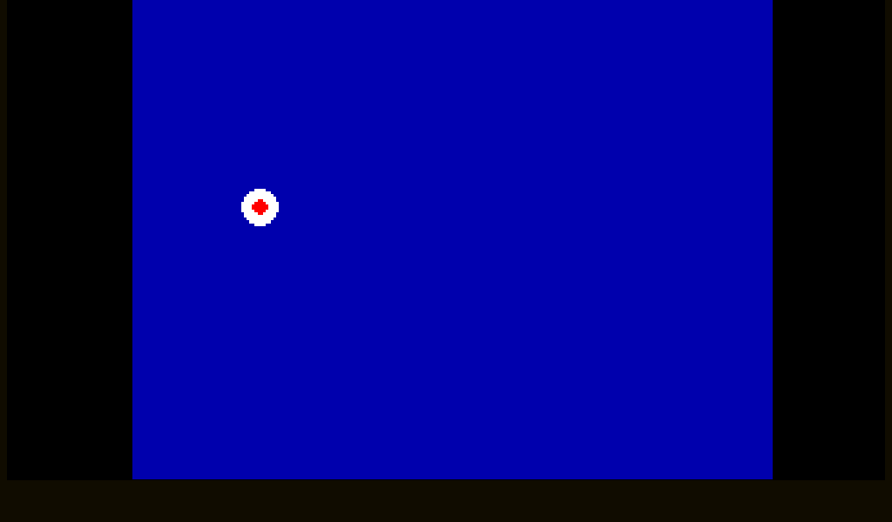
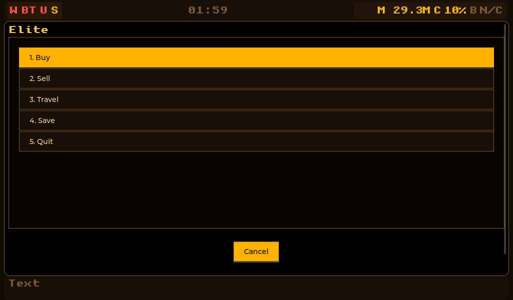
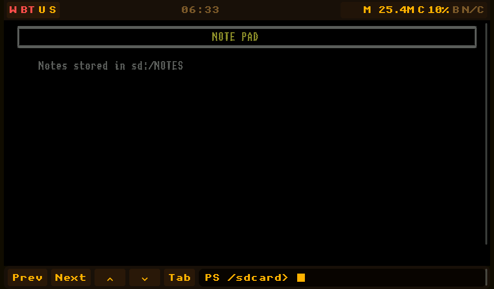
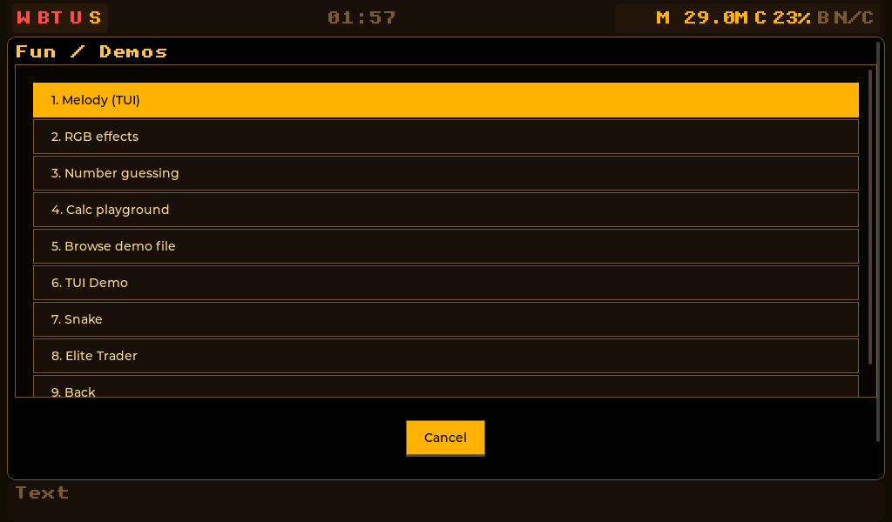
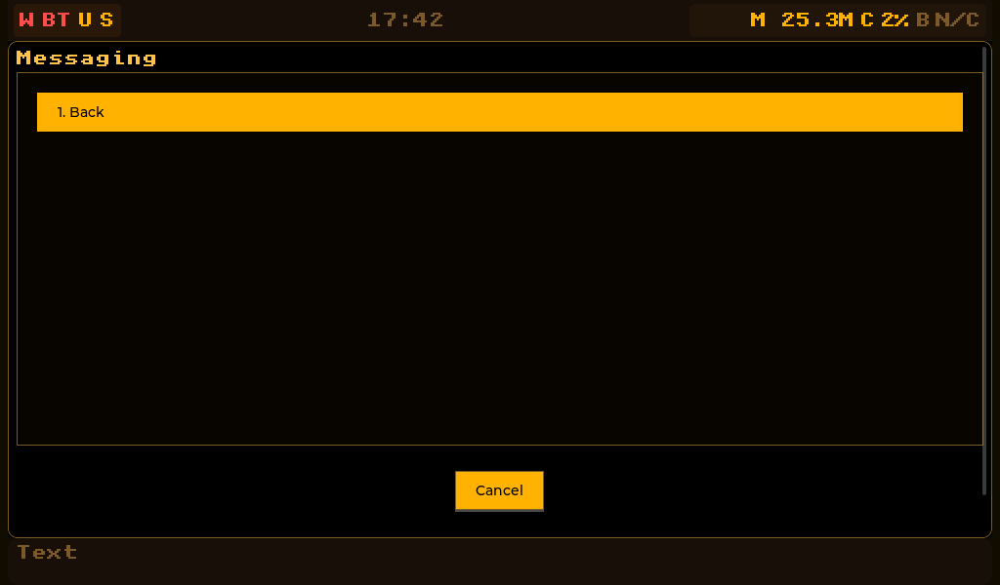
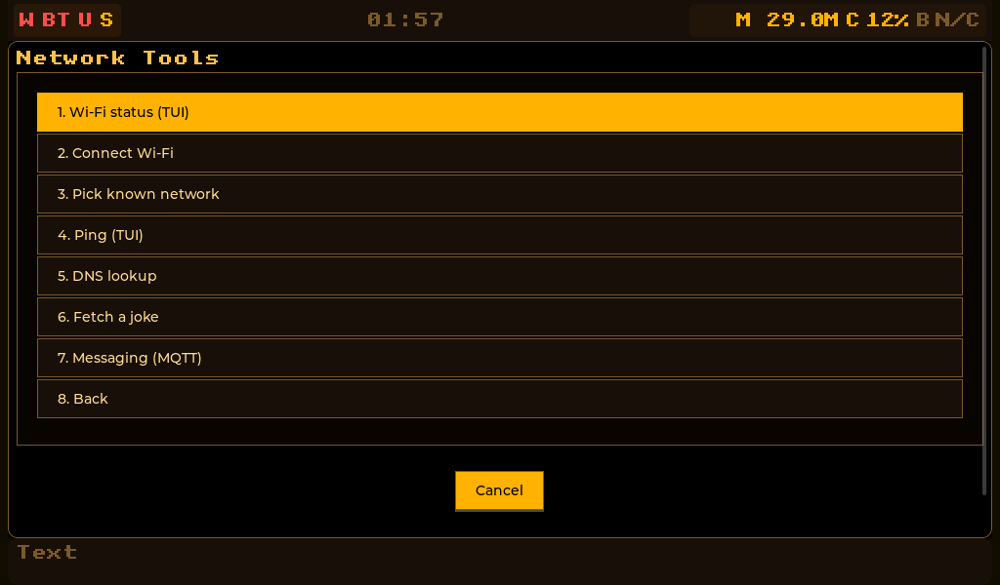
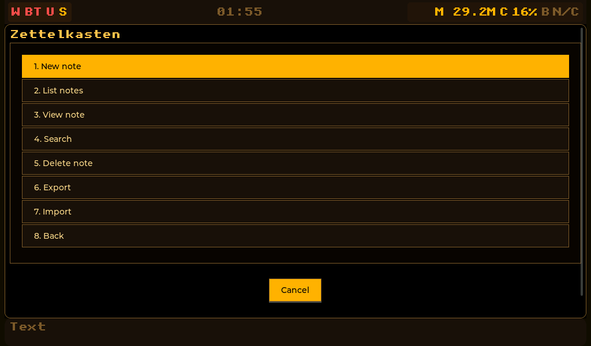
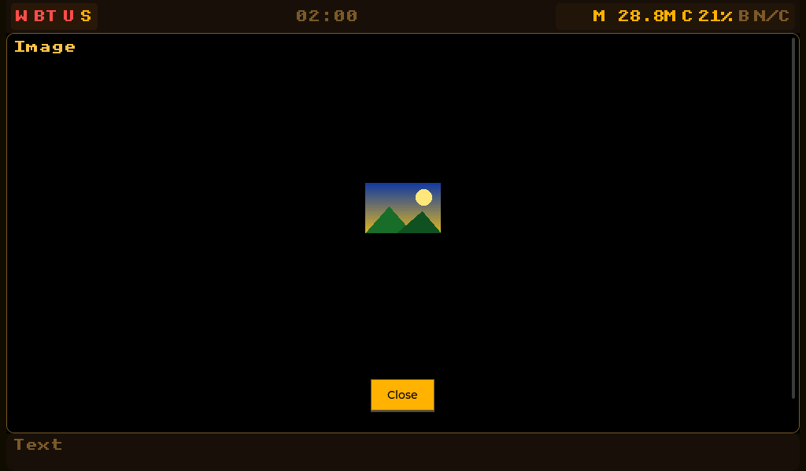
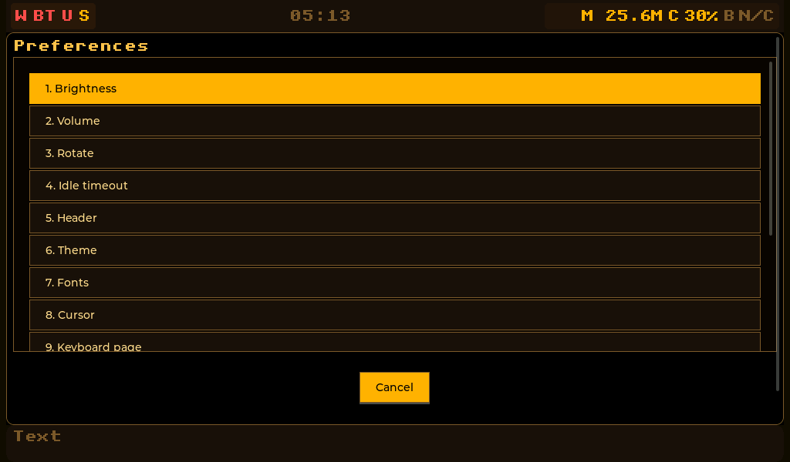

# Reference app gallery

Screenshots are normally captured live from the device by
[`tools/suites/s25_apps_gallery.py`](../tools/suites/s25_apps_gallery.py)
(JC1060P470C, 1024x600). Any image explicitly labelled a **host-generated
proof** is not a device capture; its caption says so and hardware recapture is
pending. The apps are batch-first and run from SD or USB; metadata comes from
each app's `APPINFO`.

The feature matrix in [`readme.md`](../readme.md) lists which v1.4.3
surface each app exercises (emoji, transparency, HTML, drive-aware data).

## ADVENTURE

*Screenshot: `docs/assets/apps/adventure.png`*

## Bounce Demo

Gfx pixel-canvas bouncing ball on the app drive: raster verbs plus batch math in a killable frame loop

*Screenshot: `docs/assets/apps/bounce.png`*

## Chat

Board-to-board chat over the local link (SoftAP + HTTP)

*Screenshot: `docs/assets/apps/chat.png`*

## P4 Companion

A pure-batch system helper: dashboard, files, network, games, settings

*Screenshot: `docs/assets/apps/companion.png`*

## P4 Diagnostics

System health, capability and frame-rate diagnostics console; mem shows internal heap + PSRAM

*Screenshot: `docs/assets/apps/diag.png`*

## Elite Trader

Turn-based space trading: markets, travel, pirates, saves on the app drive

*Screenshot: `docs/assets/apps/elite.png`*

## FILES-NOTES

*Screenshot: `docs/assets/apps/files-notes.png`*

## File Tools

Browse, view, search, trash, clipboard and note pad on %APPDRIVE%

*Screenshot: `docs/assets/apps/files.png`*

## Fun / Demos

Melody, RGB effects, number guessing, calc, Snake and Elite Trader

*Screenshot: `docs/assets/apps/fun.png`*

## Gfx Toolkit

Raster toolkit demo: triangle/ellipse/polygon/flood-fill/spans plus scaled on-canvas text

*Host-generated proof (hardware recapture pending): `docs/assets/apps/gfxtool.png`*

This one image is not a device capture: it is rendered on the host from the real
gfx core by [`tools/make_gfx_proof.py`](../tools/make_gfx_proof.py), with the
text drawn after the sprite stamps as the fixed `GFXTOOL.BAT` does.

## Mood Dashboard

Live board mood from free heap: RGB/audio bands plus mem (heap + PSRAM) and sysinfo snapshots

*Screenshot: `docs/assets/apps/mood.png`*

## NET-MSG

*Screenshot: `docs/assets/apps/net-msg.png`*

## Network Tools

Wi-Fi status, connect, ping, DNS, fetch and the MQTT messaging view

*Screenshot: `docs/assets/apps/net.png`*

## Zettelkasten Notes

Linked notes on the db record store: categories, search, export/import (db store is SD-only)

*Screenshot: `docs/assets/apps/notes.png`*

## PalmTop Demos

Reference app for timer/calc/csv/crypt/bind/tcpterm on the app drive

*Screenshot: `docs/assets/apps/palmtop.png`*

## Pictures

BMP image viewer, TUI draw, and gfx canvas blit on the app drive (needs PHOTO.BMP)

*Screenshot: `docs/assets/apps/pics.png`*

## Plotter

Scientific graphs: sin/cos on a world-coordinate window with axes and grid

*Screenshot: `docs/assets/apps/plot.png`*

## Preferences

Brightness, volume, rotate, theme, fonts, input and security (CONFIG.SYS)

*Screenshot: `docs/assets/apps/set.png`*

## Snake

TUI snake: fixed body slots, timeout steering, one flush per frame

*Screenshot: `docs/assets/apps/snake.png`*

## Live System

Live dashboard: memory (heap + PSRAM), tasks, services, packages

*Screenshot: `docs/assets/apps/sys.png`*

## Task Manager

Batch task manager: pool jobs, priorities, services, events; pool view reports mem incl. PSRAM

*Screenshot: `docs/assets/apps/taskmgr.png`*

## Commander

Dual-pane file commander: browse selectors plus copy/move/delete/mkdir/rename/view/edit on the app drive

*Screenshot: `docs/assets/apps/tcmd.png`*

## Browser

Renders a basic website from <drive>/WEB/ with the html page verb

*Screenshot: `docs/assets/apps/web.png`*

## Webapp Demo

Batch-first reference app for the `webapp` facade: opens the local `WEB/` page,
dumps colour runs and shows CSS/JS through the shared browser engine.

*Proof: host-generated proof pending - no device screenshot is claimed for this
board-free release candidate.*
