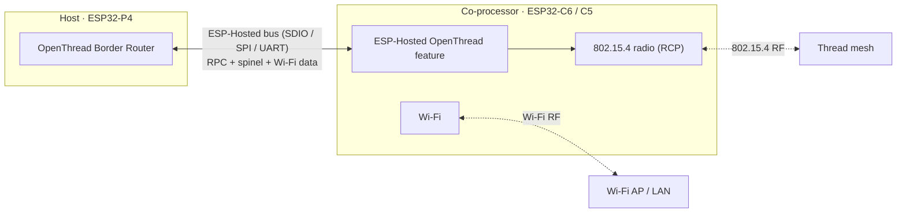
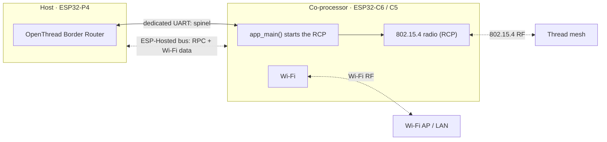
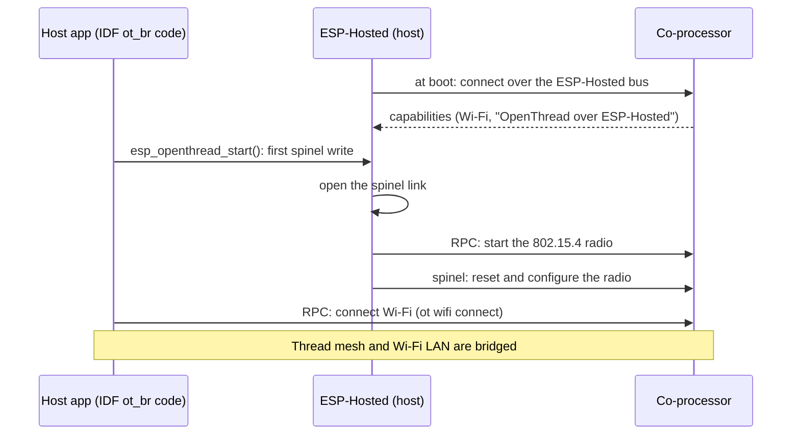

# Thread Border Router — RCP on the ESP-Hosted co-processor — Host

A Thread Border Router on the host. It connects a Thread mesh to your Wi-Fi network. One co-processor gives the host **two radios**: the 802.15.4 radio for Thread (the Radio Co-Processor, RCP) and Wi-Fi for the backhaul. The host runs the full border router stack (border routing, mDNS, NAT64). Adapted from `esp-idf/examples/openthread/ot_br`.

## How it works

The host runs the OpenThread Border Router (mDNS, NAT64). The co-processor is its 802.15.4 radio, the Radio Co-Processor (RCP). Spinel, the protocol between the Thread stack and the radio, takes one of two paths. Pick one; both sides must match.

### Default: spinel over the ESP-Hosted bus (hosted OpenThread)

Nothing to set: `sdkconfig.defaults` select this. No extra wires.



Needs an ESP-IDF with the OpenThread custom transport (ESP-IDF master).

### Option: spinel on a dedicated UART (standard OpenThread)

Like ESP-IDF `ot_rcp` + `ot_br`: ESP-Hosted does not carry spinel. Two extra wires (TX, RX). Use it when your ESP-IDF has no custom transport; ESP-IDF then selects UART on its own.



| Set this | Co-processor (`cp`) | Host (`esp_host`) |
| :--- | :--- | :--- |
| Spinel link (ESP-IDF OpenThread menu) | `CONFIG_OPENTHREAD_RCP_UART=y` | `CONFIG_OPENTHREAD_RADIO_SPINEL_UART=y` |
| UART pins, port, baud (Example Configuration) | `EXAMPLE_RCP_UART_*` | `EXAMPLE_HOST_UART_*` |

The ESP-Hosted OpenThread feature then stays inactive on both sides; leave its setting as it is.

### Start-up (default path)



The app is the ESP-IDF `ot_br` code. In `esp_ot_config.h`, `ESP_OPENTHREAD_DEFAULT_RADIO_CONFIG()` is `ESP_HOSTED_OPENTHREAD_RADIO_CONFIG()` on the ESP-Hosted transport. On the dedicated UART, it is a UART config from `EXAMPLE_HOST_UART_*`, and ESP-Hosted has no part in OpenThread.

> [!NOTE]
> Thread and Wi-Fi share one radio on the ESP32-C6, so each gets part of the air time. For two separate radios (P4 + C6 for Wi-Fi + H2 for Thread), see the [ESP-Thread-BR P4 example](https://github.com/espressif/esp-thread-br/blob/main/examples/basic_thread_border_router/README_esp32p4.md) and the [C6 coexistence guide](https://docs.espressif.com/projects/esp-idf/en/latest/esp32c6/api-guides/coexist.html).

## Supported Platforms and Transports

### Supported Coprocessors

OpenThread uses an 802.15.4 radio co-processor (RCP).

| Coprocessor | ESP32-C6 | ESP32-H2 | ESP32-H4 | ESP32-C5 |
| :---------: | :------: | :------: | :------: | :------: |
| Support     | Yes      | Yes      | Yes      | Yes      |

### Supported Host Devices

| Host Device | ESP32-P4 | ESP32-H2 | Other MCUs | Linux |
| :---------: | :------: | :------: | :--------: | :---: |
| Support     | Yes | Yes | [Yes](https://github.com/espressif/esp-hosted/blob/master/docs/getting-started-mcu.md) | [Yes](https://github.com/espressif/esp-hosted/blob/master/docs/getting-started-linux.md) |

### Supported Connection buses

| Connection bus | SDIO | SPI Full-Duplex | SPI Half-Duplex | UART |
| :------------- | :--: | :-------------: | :-------------: | :--: |
| Linux host     | Yes  | Yes             | No              | No   |
| MCU host       | Yes  | Yes             | Yes             | Yes  |

```bash
cd examples/openthread/rcp_on_hosted_cp/border_router/esp_host
idf.py set-target esp32p4
idf.py menuconfig
```

Check two settings. Both must match the co-processor:

1. **Bus to the co-processor:**

   ```text
   Component config → ESP-Hosted → Configure host → Host transport
     └── Communication bus:  (X) SDIO   ( ) SPI Full Duplex   ( ) SPI Half Duplex   ( ) UART
   ```

2. **Spinel link** (ESP-IDF OpenThread menu):

   ```text
   Component config → OpenThread → Thread Core Features → Thread 15.4 Radio Link
     └── Config the Thread radio type with 15.4 link:  (X) Connect via Custom Transport   ( ) Connect via UART
   ```

   - **Connect via Custom Transport** (default): hosted OpenThread, with `Features → OpenThread RCP on the co-processor` on.
   - **Connect via UART**: standard OpenThread. ESP-Hosted has no part in it. Set the UART in *Example Configuration → Dedicated spinel UART* (`EXAMPLE_HOST_UART_PORT`, `_TX_PIN`, `_RX_PIN`, `_BAUDRATE`). `sdkconfig.defaults.esp32p4` sets the P4 pins.

These settings are already in `esp_host/sdkconfig.defaults` (and `sdkconfig.defaults.esp32p4`). Keep them:

```text
CONFIG_ESP_HOSTED_HOST_FEAT_OPENTHREAD=y     # hosted OpenThread feature
CONFIG_ESP_HOSTED_HOST_FEAT_WIFI=y           # Wi-Fi backhaul
CONFIG_ESP_HOSTED_HOST_FEAT_RPC_EXT_V2=y     # needed by the feature
CONFIG_OPENTHREAD_ENABLED=y
CONFIG_OPENTHREAD_BORDER_ROUTER=y            # border router role
CONFIG_OPENTHREAD_RADIO_SPINEL_CUSTOM=y      # spinel on the ESP-Hosted bus
CONFIG_SPIRAM=y                              # the host does not start without PSRAM
CONFIG_OPENTHREAD_RX_ON_WHEN_IDLE=n          # pairs with the co-processor's SW coexistence
```

The `Component config → OpenThread` and `Component config → LWIP` menus hold the border router settings (IPv6 forwarding, NAT64 hooks). The defaults are correct.

Flash and monitor:

```bash
idf.py -p <host_usb_serial_port> flash monitor
```

<!-- generated from ../README.md — edit that file, not this one -->
