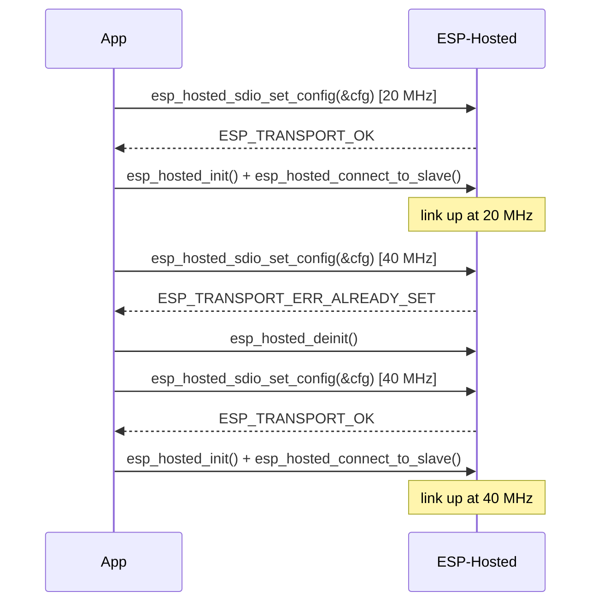

# Manual bring-up — Host

Sets the bus clock from the application (no auto-init): start the link at one clock,
then stop it and start it again at another. All of it is in `main.c`; Wi-Fi, BLE and
a link monitor are optional extras in their own files.

Use it when the application, not menuconfig, decides the bus settings (for example
from a board ID or NVS), or when you want to control when Wi-Fi and BLE start.

### Changing the bus settings



```c
struct esp_hosted_sdio_config cfg = INIT_DEFAULT_HOST_SDIO_CONFIG();
cfg.clock_freq_khz = 40000;
esp_hosted_sdio_set_config(&cfg);   // before esp_hosted_init(), or after esp_hosted_deinit()
esp_hosted_init();
esp_hosted_connect_to_slave();      // log: bus applied: clk_khz=40000
```

- Settings can change only while the link is down. While it is up, `set_config`
  returns `ESP_TRANSPORT_ERR_ALREADY_SET`.
- Without `set_config`, the menuconfig values are used.
- The same works for SPI, SPI half duplex and UART (`esp_hosted_spi_set_config()`,
  `esp_hosted_spi_hd_set_config()`, `esp_hosted_uart_set_config()`).

| Bus | First start | After restart | Fixed (rejected if changed) |
| :--- | :--- | :--- | :--- |
| SDIO | 20000 kHz | 40000 kHz | `rx_mode`, `block_mode` |
| SPI | 20 MHz | 26 MHz | — |
| SPI half duplex | 20 MHz | 40 MHz | command/address/dummy bits (8) |
| UART | 921600 | 921600 (must match the co-processor) | — |

## Supported Platforms and Transports

### Supported Coprocessors

| Coprocessor | ESP32 | ESP32-C Series | ESP32-S2/S3 | ESP32-S31 |
| :----------: | :---: | :------------: | :---------: | :-------: |
| Support     | Yes   | Yes            | Yes         | No ¹      |

¹ ESP32-S31: not supported yet. No host-wakeup GPIO is set for the [ESP32-S31 test board](https://github.com/espressif/esp-hosted/blob/master/docs/getting-started-mcu.md#esp32-s31-test-board-on-the-esp32-p4-function-ev-board).

### Supported Host Devices

| Host Device | ESP32-P4 | ESP32-H2 | Other MCUs | Linux |
| :---------: | :------: | :------: | :--------: | :---: |
| Support     | Yes | Yes | [Yes](https://github.com/espressif/esp-hosted/blob/master/docs/getting-started-mcu.md) | No |

### Supported Connection buses

| Connection bus | SDIO | SPI Full-Duplex | SPI Half-Duplex | UART |
| :------------- | :--: | :-------------: | :-------------: | :--: |
| MCU host       | Yes  | Yes             | Yes             | Yes  |

Select the same transport as the co-processor:

```bash
cd examples/system/mcu_transport_config/mcu_host
idf.py set-target esp32p4
idf.py menuconfig
```

```text
Component config
└── ESP-Hosted
     └── Configure host
          └── Host transport
               └── Communication bus (co-processor <== bus ==> host)
                    ├── ( ) SPI Full Duplex
                    ├── (X) SDIO                    <── default (match the co-processor)
                    ├── ( ) SPI Half Duplex
                    └── ( ) UART
```

```text
Example Configuration
├── [*] Stage 2: bring up Wi-Fi STA        <── default on
├── (myssid)      Wi-Fi SSID
├── (mypassword)  Wi-Fi password
└── [*] Stage 3: bring up BLE advertising  <── default on
```

Pre-set in `sdkconfig.defaults` (do not remove):

```text
CONFIG_ESP_HOSTED_AUTO_CALL_INIT_BEFORE_APP_MAIN=n   # the app starts ESP-Hosted itself
CONFIG_ESP_HOSTED_HOST_AUTO_FEAT_INIT=n              # the app starts each feature itself
```

Then flash and monitor:

```bash
idf.py -p <host_usb_serial_port> flash monitor
```

<!-- generated from ../README.md — edit that file, not this one -->
