# P4Sync — desktop companion for P4MiniShell

P4Sync is a **host-side** companion for P4MiniShell. It does **not** replace or
fork the firmware, and it contains **no second serial, framing, SDFX/BMPX/PIMX
or CRC implementation**. Every device operation goes through the existing
harness (`tools/p4test`, `tools/pim_sync`) via one Python facade
(`tools/p4sync/client.py`). The firmware contribution is read-only: the
`sync status` capability snapshot, extended with `sync.shot_max` and
`sync.xfer_chunk` (mapped by the host as `limit.screenshot` and
`limit.transfer`).

Three front ends share the same implementation:

| Front end | Entry point | Use |
|-----------|-------------|-----|
| Agent CLI | `python tools/p4sync <cmd> ...` | Scriptable, `--json` machine output, stable flags |
| JSON bridge | `python tools/p4sync/bridge.py` | stdin/stdout process used by the GUI |
| Native Windows 11 GUI | `apps/p4sync_gui` | WPF app with nine pages; no C# serial code |

**A mock pass is a host demonstration, not hardware sign-off.** The screenshots
below are real captures of the shipped WPF app launched with `--mock`; no board
was attached when they were taken. See [`harness.md`](harness.md) §0.

---

## What it can do

| Area | Capability |
|------|-----------|
| Discovery | `devices` — board slug, port, proto tag and status from the bridge; no hardcoded COM port |
| Handshake | `status` — proto `p4sync-1`, board, SD/lock state, magics and byte caps; a mismatch refuses every device command |
| Full shell over USB | `shell` — arbitrary command via the harness marker-synced `Device.run`, ANSI-stripped stdout plus `ERRORLEVEL` |
| Raw file transfer over USB | `push` / `pull` — one file at a time through SDFX, with temp `.part` + CRC verification and resume |
| Incremental sync | `plan` — `(path,size,mtime,crc32)` diff with dry-run/apply, newer-wins policy and conflict flags |
| Screenshot | `screenshot` / `shot` — one BMPX capture; returns an absolute PNG path, `png_base64`, `sha256`, `size`, `width`, `height` |
| PIM image | `full-image` — handshake + PIM sync + file provisioning + app inventory + screenshot + `image.json`; detects and rebuilds a stale manifest |
| Verification | `verify` — CRC/read-back check; non-zero exit on failure |
| Packages | `pkg` — existing `pkg` verbs through the bridge, no direct device commands from C# |
| Credentials | Windows Credential Manager with DPAPI fallback; passed only as child-process environment variables, never stored in the repo |

---

## CLI (agents and scripts)

Every bridge command is also a CLI subcommand. Flags are stable and the
`--json` payload is the same `data` object the bridge returns; failures exit
non-zero.

```powershell
python tools/p4sync devices --json
python tools/p4sync status --json --port COM3
python tools/p4sync shell --port COM3 --command "ver" --timeout 25 --settle 4000 --json
python tools/p4sync push --port COM3 --local sd:/APPS/HELLO.BAT --remote sd:/APPS/HELLO.BAT --json
python tools/p4sync pull --port COM3 --remote sd:/APPS/HELLO.BAT --local .\HELLO.BAT --json
python tools/p4sync plan --mirror .\mirror --dry-run --json
python tools/p4sync screenshot --port COM3 --out .\screen.png --json
python tools/p4sync full-image --mirror .\mirror --db p4sync --files true --shot true --json
python tools/p4sync verify --port COM3 --crc32 <expected> --json
python tools/p4sync pkg --port COM3 --json
```

The legacy verbs `status`, `push`, `pull`, `shot` and `full-image` remain
backwards-compatible; `shot` is an alias for `screenshot`. Add `--mock` to any
command for a deterministic, board-free demonstration.

Full contract and fixtures: [`tools/p4sync/README.md`](tools/p4sync/README.md).

## JSON bridge

Launch `python tools/p4sync/bridge.py [--mock]`; one request per stdin line,
JSON only on stdout (diagnostics go to stderr):

```json
{"id":1,"cmd":"devices"}
{"id":2,"cmd":"status","port":"COM3"}
{"id":3,"cmd":"shell","port":"COM3","command":"ver","timeout":25,"settle":4000}
```

Responses are `{"id":N,"ok":true,"data":{...}}` or
`{"id":N,"ok":false,"error":"E_..."}`. Progress and log events use
`{"event":"progress"|"log","id":N,...}`.

---

## Native Windows 11 GUI (mock-mode screenshots)

Build and run offline:

```powershell
dotnet build apps/p4sync_gui/P4SyncGui.sln -c Release
dotnet run --project apps/p4sync_gui/src/P4SyncGui -- --mock --page dashboard
```

Deep-link keys: `devices`, `dashboard`, `files`, `screenshot`, `pim`, `apps`,
`shell`, `plan`, `settings`. Reproduce all of the captures below with
`powershell -ExecutionPolicy Bypass -File tools/p4sync/capture_gui_shots.ps1`.

| Page | What it shows |
|------|---------------|
| **Devices** | Bridge-discovered boards (no hardcoded ports); selection is injected as the `port` argument on every request. |
| **Dashboard** | Read-only `sync status` snapshot: proto tag, SD/lock state, transfer magics and byte caps. Protocol mismatch refuses device commands. |
| **Files** | Local/device listing, dry-run plan, one-file push/pull and the newer-wins conflict policy. |
| **Screenshot** | One BMPX capture decoded into a PNG preview from the exact bridge bytes (`png_base64`/`out`), with `sha256`/`size` verification and Save-as. |
| **PIM** | `full-image` Contacts/Calendar/Details, with a warning banner when a stale `image.json` is rebuilt. |
| **Apps & Packages** | `pkg` verbs and CRC verify, all through the bridge. |
| **Shell** | Full USB shell: command history, ANSI/plain toggle, timeout/settle controls and a destructive-command acknowledgement. |
| **Plan & Report** | Dry-run plan, progress log, verbatim raw JSON and cooperative cancel. |
| **Settings** | Bridge path, mock mode, theme and OS credential handling. |

### Devices — bridge-owned discovery

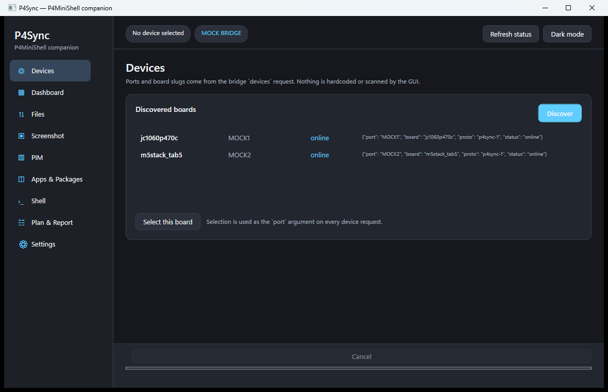

### Dashboard — capability handshake

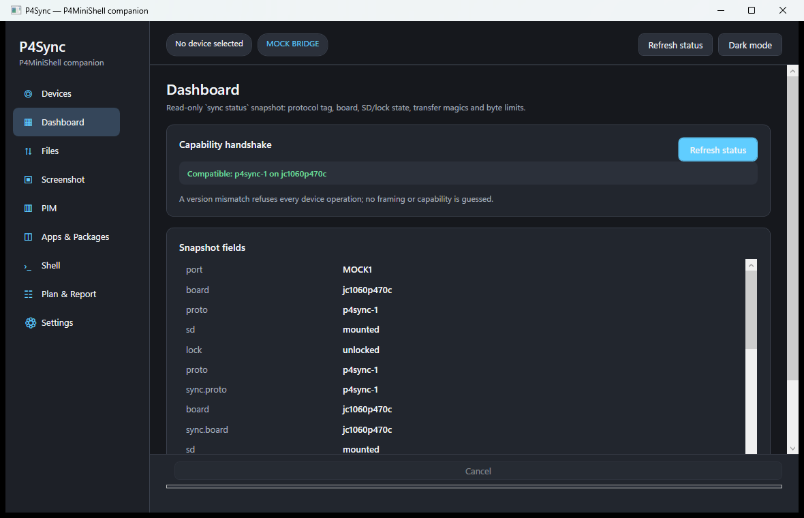

This capture was taken from the **standalone release zip**, extracted to a
fresh directory: the bundled `P4SyncGui.exe` found the bundled bridge and
reported `Compatible: p4sync-1 on jc1060p470c`. That verifies the shipped
binary bundle is runnable without a source checkout or a .NET install.

## Downloadable Windows binary

`python tools/make_release.py p4sync` publishes `release/p4sync-windows-x64-<version>.zip`
(the artifact uploaded to the GitHub release). Contents: self-contained WPF
GUI (`P4SyncGui/P4SyncGui.exe`), the agent CLI/bridge, the harness modules it
imports, `run-p4sync.cmd`, this guide and the licence. The packer verifies
required entries and refuses credentials, private keys, `__pycache__` and
MSBuild outputs.

```powershell
# after extracting the zip on Windows 11 x64
python -m pip install pyserial
run-p4sync.cmd                       # or: P4SyncGui\P4SyncGui.exe --mock
```

Verified from an extracted bundle: the bridge returned a valid `status` JSON
object and the GUI completed the `p4sync-1` handshake. Installation of a real
board firmware is still required for hardware sign-off.

### Files — dry-run plan and one-file transfer

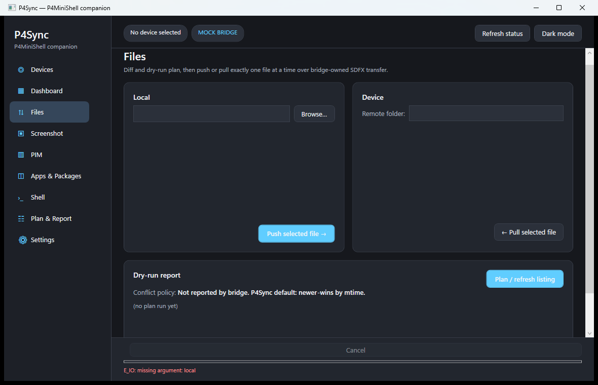

### Screenshot — real bridge PNG preview

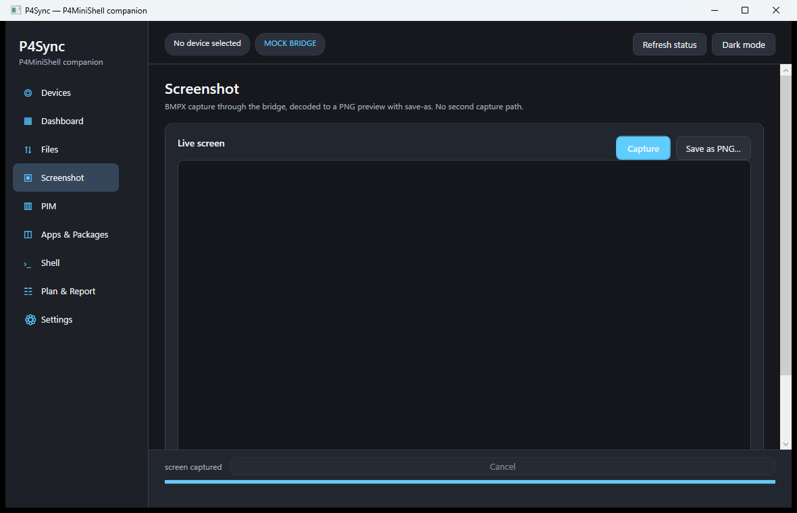

### PIM — full-image mirror

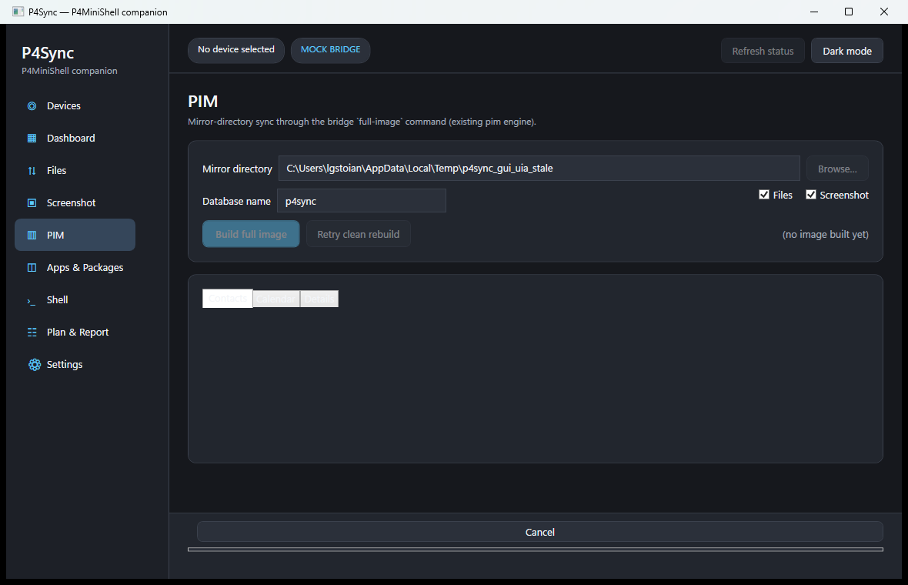

### Apps & Packages

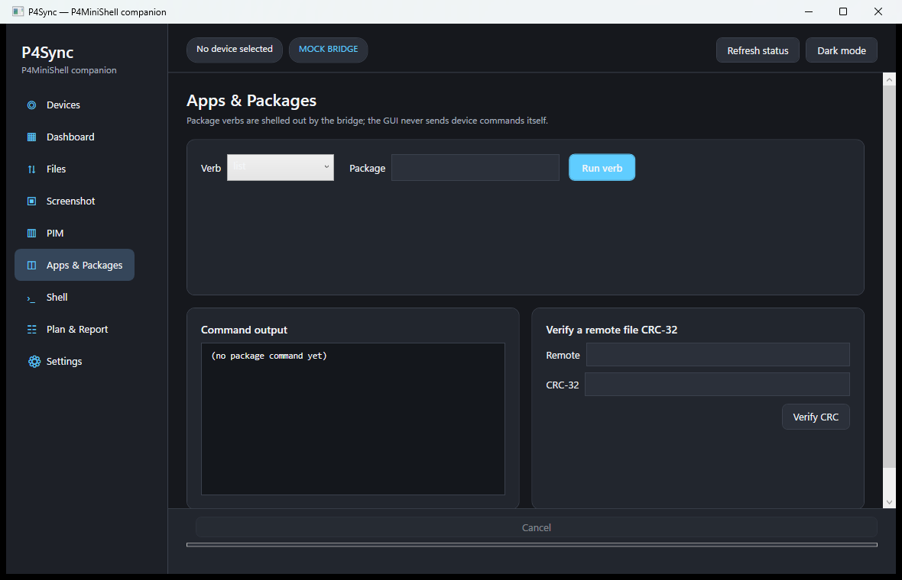

### Shell — full shell access over USB

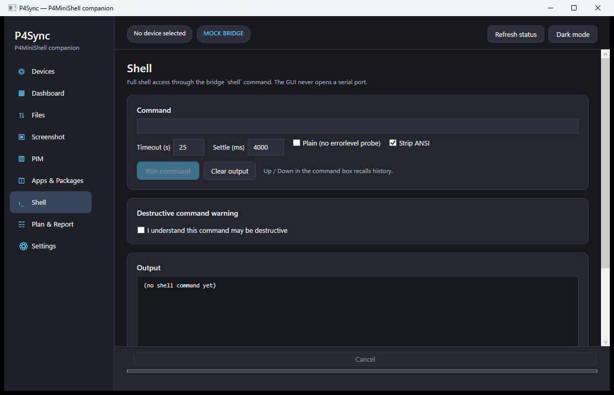

### Plan & Report

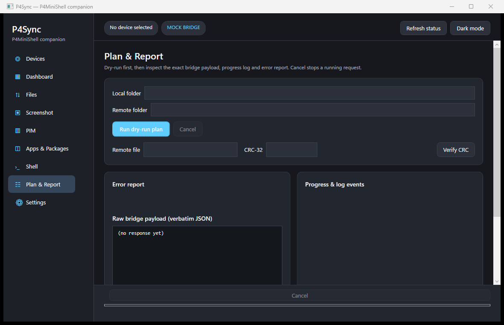

### Settings

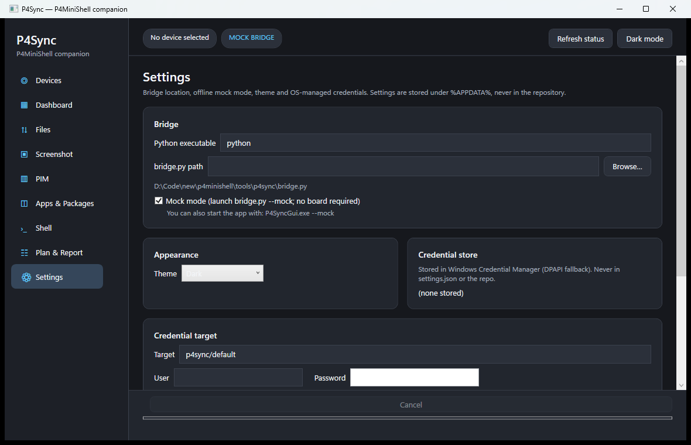

### Drop-down contrast (dark and light theme)

The Package verb and Theme selection drop-downs are checked in both themes by
`apps/p4sync_gui/capture_dropdowns.ps1`; text/background pairs must clear
4.5:1. White-on-white in the dark theme was found and fixed in the shared
theme template. Dark before → after:

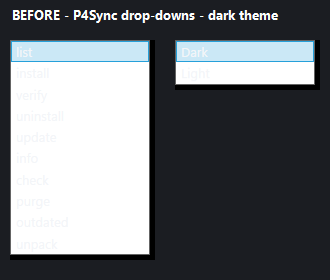

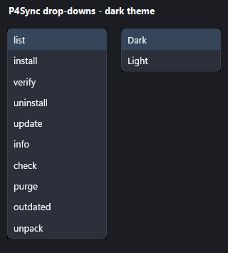

Light theme after:

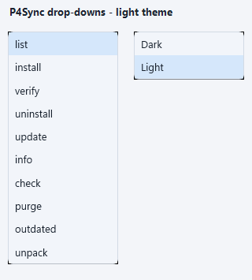

GUI details and the full contrast evidence are in
[`apps/p4sync_gui/README.md`](apps/p4sync_gui/README.md).

---

## Tests and gates (board-free)

```powershell
python tools/p4sync_gate.py --check       # 51 checks
python tools/p4sync_gate.py --self-test   # 18 canaries (bad proto, corrupt CRC,
                                          #  missing marker, second-serial regression)
python tools/host_all_gates.py --only p4sync,p4sync_canary
dotnet run --project apps/p4sync_gui/tests/P4SyncBridge.Tests   # 18 assertions
```

The canaries deliberately make a bad handshake, a corrupt CRC, a missing
marker and a duplicate serial implementation go red. They are part of the
**47-gate / 21-canary** host pre-gate set in [`harness.md`](harness.md).

Board parity (live BMPX/PIMX/SDFX and a board-run `full-image` rebaseline)
requires the attached boards and is tracked in [`release.md`](release.md).

## Integration notes

- No firmware change was needed for the host side; the read-only `sync`
  capability lines are additive and preserve every existing `sync.*` line.
- P4Sync wraps the harness; it will fully replace it only after full feature
  parity is proven. No harness feature was removed or duplicated.
- Credentials and local Wi-Fi config are never committed
  (`tools/wifi_local.json` is git-ignored).
